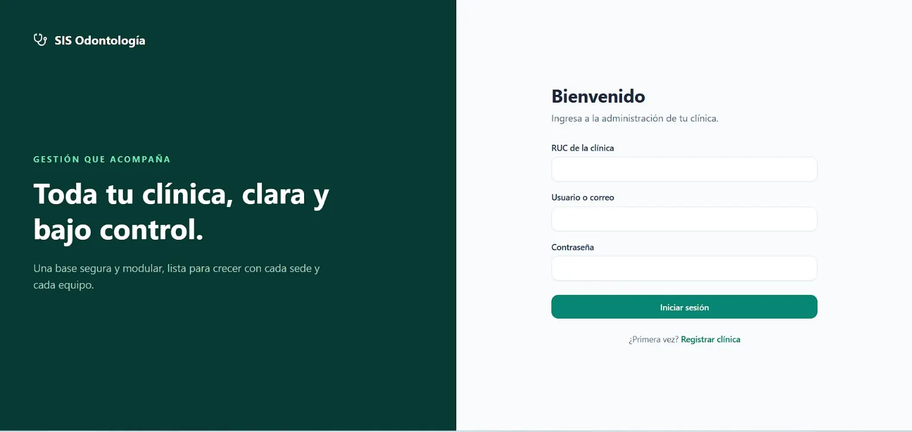
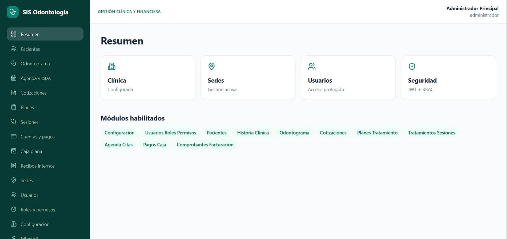
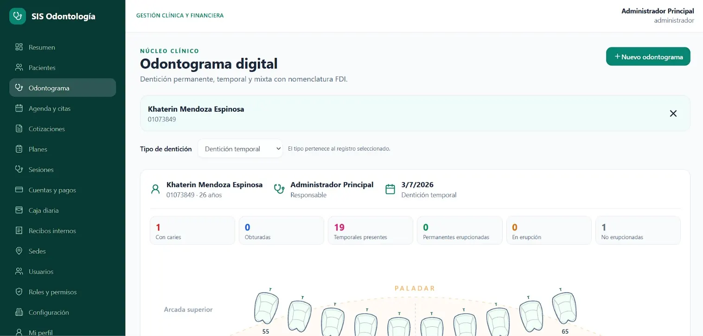
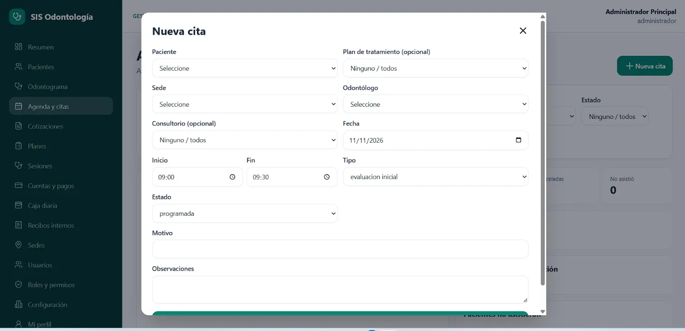

<div align="center">

# 🦷 SIS Odontología
### Sistema web de gestión clínica y financiera odontológica

**FastAPI · React · TypeScript · PostgreSQL · Docker**


**Proyecto de desarrollo y demostración con datos ficticios.**

</div>

## 📋 Descripción

**SIS Odontología** es una aplicación web para centralizar los procesos administrativos, clínicos y financieros de una clínica odontológica. Integra el seguimiento del paciente, la gestión de citas y tratamientos, el odontograma digital y el control de pagos en una interfaz unificada.

La arquitectura separa una API REST desarrollada con **FastAPI** de una aplicación frontend en **React y TypeScript**, utilizando **PostgreSQL** para la persistencia de datos.

## ✨ Funcionalidades

| Área | Capacidades |
| --- | --- |
| **Administración** | Clínicas, sedes, usuarios, roles y permisos |
| **Pacientes** | Registro, búsqueda, antecedentes e historia clínica |
| **Odontograma digital** | Dentición permanente, temporal y mixta; registro de hallazgos |
| **Agenda de citas** | Programación, filtros, estados y vinculación con tratamientos |
| **Tratamientos** | Cotizaciones, planes, procedimientos y sesiones |
| **Gestión financiera** | Cuentas por cobrar, pagos mixtos, caja y recibos internos |
| **Seguridad** | Autenticación JWT, renovación de sesión, control de acceso RBAC y auditoría |

> El proyecto se encuentra en desarrollo. Las interfaces y funciones deben validarse integralmente antes de utilizarlo con información clínica real.

## 📸 Vista previa del sistema

### Inicio de sesión

Acceso a la plataforma mediante los datos de la clínica y las credenciales de usuario.



### Panel principal

Resumen administrativo y acceso a los módulos de gestión clínica y financiera.



### Odontograma digital

Visualización de la dentición y registro de condiciones odontológicas para el seguimiento del paciente.



### Agenda de citas

Formulario para programar una atención con paciente, profesional, sede, fecha, horario y observaciones.



*Capturas realizadas en el entorno de demostración del proyecto.*

## 🛠️ Tecnologías

| Capa | Herramientas |
| --- | --- |
| Frontend | React, TypeScript, Vite, Tailwind CSS |
| Backend | Python, FastAPI, SQLAlchemy 2 |
| Base de datos | PostgreSQL |
| Migraciones | Alembic |
| Autenticación y autorización | JWT, bcrypt, RBAC |
| Entorno de desarrollo | Docker Compose |

## 🏗️ Arquitectura

```text
sis_odontologia/
├── backend/
│   ├── alembic/           # Migraciones
│   ├── app/
│   │   ├── api/           # Rutas y endpoints
│   │   ├── core/          # Configuración y seguridad
│   │   ├── db/            # Persistencia y datos de prueba
│   │   ├── dependencias/  # Autorización
│   │   ├── esquemas/      # Validación de datos
│   │   ├── modelos/       # Modelos de base de datos
│   │   ├── repositorios/
│   │   └── servicios/
│   └── tests/
├── frontend/
│   └── src/               # Interfaz y componentes
└── docker-compose.yml
```

La aplicación contempla separación de información entre clínicas, roles y permisos, y mecanismos de auditoría sobre operaciones relevantes.

## 🚀 Ejecutar el proyecto con Docker

**Requisitos:** Docker y Docker Compose.

1. Copia `.env.example` como `.env` y revisa la configuración del entorno.
2. Desde la raíz del proyecto, ejecuta:

```powershell
docker compose up --build
```

3. Abre los servicios locales:

| Servicio | Dirección |
| --- | --- |
| Aplicación web | http://localhost:5173 |
| Documentación API | http://localhost:8000/docs |
| Verificación de salud | http://localhost:8000/salud |

Docker aplica las migraciones y prepara los datos iniciales según la configuración del proyecto.

## 💻 Ejecución sin Docker

**Backend** (necesita PostgreSQL configurado):

```powershell
cd backend
python -m venv .venv
.venv\Scripts\Activate.ps1
python -m pip install -r requirements.txt
alembic upgrade head
python -m app.db.semillas
uvicorn app.main:app --reload
```

**Frontend** (en otra terminal):

```powershell
cd frontend
npm install
npm run dev
```

## 🔑 Acceso de demostración

Las siguientes credenciales son **exclusivamente ficticias para pruebas locales**:

| Campo | Valor |
| --- | --- |
| RUC | `20123456789` |
| Usuario | `admin` |
| Contraseña | `Admin12345*` |

No deben reutilizarse en una instalación real o accesible desde Internet.

## 🧪 Pruebas

El backend incluye pruebas automatizadas de autenticación, acceso por clínica, odontograma, agenda, tratamientos y operaciones financieras. Para ejecutarlas:

```powershell
cd backend
pytest -q
```

La existencia de estas pruebas no implica una certificación para entornos clínicos de producción.

## 🔒 Consideraciones

- El repositorio está destinado a desarrollo, aprendizaje y demostración.
- No deben publicarse archivos `.env`, claves privadas ni datos personales de pacientes.
- La facturación electrónica SUNAT no está integrada.
- Para un despliegue real, se requiere una revisión de seguridad, respaldos, rendimiento, trazabilidad y cumplimiento normativo.

## 👨‍💻 Autor

**Víctor Pérez Valqui**  
Ingeniería de Sistemas e Informática  
GitHub: [@pevalvictor](https://github.com/pevalvictor)

---

<div align="center"><sub>Desarrollado con Python, React y PostgreSQL.</sub></div>
