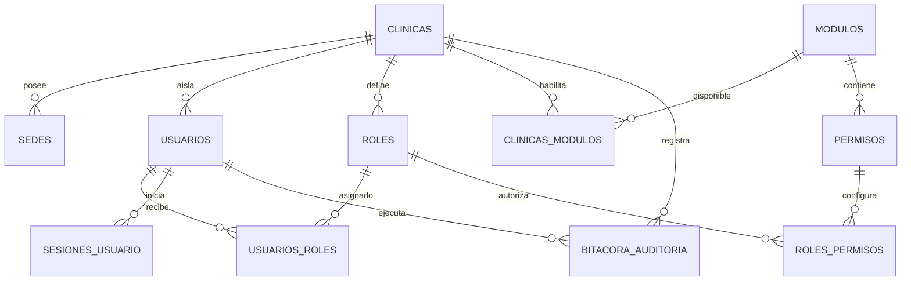

# SIS Odontología — Fases 0, 1 y 2

Base modular multi-clínica para gestión odontológica. Incluye FastAPI, PostgreSQL, SQLAlchemy 2, Alembic, JWT rotatorio, RBAC, auditoría, React/TypeScript, Tailwind y Docker Compose. La Fase 2 incorpora sesiones, cuentas por cobrar, pagos mixtos, caja diaria y recibos internos. No incluye facturación electrónica SUNAT.

## Arquitectura

- `frontend`: SPA React con rutas protegidas, sesión renovable y menú administrativo.
- `backend`: API por capas (`api`, `dependencias`, `servicios`, `repositorios`, `modelos`, `esquemas`).
- `db`: PostgreSQL. Todas las tablas, columnas, modelos y migraciones usan español.
- Multi-clínica: el `clinica_id` se obtiene exclusivamente del access token validado. Las consultas de recursos de clínica agregan ese filtro en servidor.
- Seguridad: bcrypt, access token de 30 minutos, refresh token de 7 días y rotación/revocación persistente; login limitado a 10 intentos/minuto/IP.
- Autorización: primero valida módulo activo; luego rol/permiso. El rol `administrador` tiene acceso al módulo activo completo.



## Ejecución recomendada

1. Copiar `.env.example` como `.env`. La contraseña local entregada ya figura como valor de desarrollo; cámbiela en producción.
2. Levantar el sistema:

```powershell
docker compose up --build
```

3. Abrir `http://localhost:5173`. Swagger está en `http://localhost:8000/docs` y salud en `http://localhost:8000/salud`.

Docker ejecuta `alembic upgrade head` y semillas antes de iniciar la API.

Credenciales demo:

- RUC: `20123456789`
- Usuario: `admin`
- Contraseña: `Admin12345*`

## Ejecución sin Docker para desarrollo

```powershell
cd backend
python -m venv .venv
.venv\Scripts\Activate.ps1
python -m pip install -r requirements.txt
alembic upgrade head
python -m app.db.semillas
uvicorn app.main:app --reload
```

En otra terminal:

```powershell
cd frontend
npm.cmd install
npm.cmd run dev
```

## Endpoints

Autenticación:

- `POST /api/autenticacion/registro-inicial`
- `POST /api/autenticacion/iniciar-sesion`
- `POST /api/autenticacion/refrescar-token`
- `POST /api/autenticacion/cerrar-sesion`
- `POST /api/autenticacion/recuperar-contrasena`
- `GET /api/autenticacion/mi-perfil`

Administración:

- `GET|PUT /api/clinicas/mi-clinica`
- `GET|POST /api/sedes`, `PUT|DELETE /api/sedes/{id}`
- `GET|POST /api/usuarios`, `GET|PUT /api/usuarios/{id}`, `PATCH /api/usuarios/{id}/estado`
- `GET|POST /api/roles`, `PUT /api/roles/{id}`, `PUT /api/roles/{id}/permisos`
- `GET /api/permisos`, `GET /api/modulos`
- `GET /api/clinicas/modulos`, `PUT /api/clinicas/modulos/{modulo_id}`

### Núcleo clínico y comercial — Fase 1

- Pacientes: `GET|POST /api/pacientes`, búsqueda, detalle, resumen, edición, estado, antecedentes y alergias.
- Historia: `GET|POST /api/historias-clinicas/paciente/{paciente_id}`.
- Consultas: listado, alta, edición, evoluciones, cierre y anulación bajo `/api/consultas-clinicas`.
- Odontograma: arcadas anatómicas curvas, 32 piezas adultas FDI, cinco superficies SVG seleccionables, colores por condición, autocomplete de pacientes, panel lateral e historial inmutable bajo `/api/odontogramas` y `/api/hallazgos-dentales`.
- Odontopediatría: selector de dentición permanente, temporal (20 piezas FDI) o mixta (52 piezas), sugerencia por edad, estados de erupción, pérdida prematura y sucesores FDI fijos. La migración `0008_denticion_pediatrica` conserva los odontogramas adultos existentes como permanentes.
- Agenda: CRUD y transiciones bajo `/api/citas`; vistas `/agenda/diaria` y `/agenda/semanal`.
- Catálogos de agenda: `/api/consultorios` y `/api/tipos-cita`.
- Cotizaciones: CRUD de cabecera/detalles, estado, PDF y conversión bajo `/api/cotizaciones`.
- Planes: CRUD, procedimientos, aprobación, estado y consulta por paciente bajo `/api/planes-tratamiento`.

Las cotizaciones solo realizan cálculos referenciales: no generan deuda, cobros ni movimientos de caja.

### Migraciones de Fase 1

```text
0002_nucleo_pacientes
0003_historias_consultas
0004_odontograma_digital
0005_agenda_citas
0006_cotizaciones_planes
0007_permisos_fase_1
0008_denticion_pediatrica
```

### Fase 2: tratamientos y finanzas

- Sesiones e insumos: `/api/sesiones-tratamiento`.
- Cuentas, modalidades y cuotas: `/api/cuentas-por-cobrar`.
- Pagos mixtos, aplicaciones, anulaciones y devoluciones: `/api/pagos`.
- Caja operativa y movimientos por método: `/api/cajas`.
- Recibos internos y PDF: `/api/comprobantes-internos`.

Reglas financieras principales:

- Todos los importes usan `NUMERIC(12,2)` y `Decimal`.
- Un pago requiere una caja abierta para la sede y fecha operativa.
- Cada pago posee una clave de idempotencia única por clínica.
- La suma de métodos coincide con el total recibido.
- La suma de `aplicaciones_pago` coincide con el monto aplicado.
- Un pago puede distribuirse entre múltiples cuentas o cuotas.
- Solo el efectivo afecta el efectivo físico; los demás métodos permanecen visibles en movimientos.
- El recibo interno conserva fotografías JSON inmutables de clínica, paciente, pago, métodos, aplicaciones y usuario.

Ejemplo de pago mixto aceptado:

```json
{
  "monto_total": "170.00",
  "detalles": [
    {"metodo_pago": "yape", "monto": "100.00", "numero_operacion": "YAPE-001"},
    {"metodo_pago": "efectivo", "monto": "70.00"}
  ],
  "aplicaciones": [
    {"cuenta_por_cobrar_id": 1, "cuota_cuenta_por_cobrar_id": 1, "monto_aplicado": "170.00"}
  ]
}
```

Migraciones nuevas:

```text
0009_sesiones_tratamiento
0010_cuentas_por_cobrar
0011_caja_diaria
0012_pagos_y_devoluciones
0013_comprobantes_y_permisos
```

### Datos demostrativos opcionales

Solo para desarrollo, el comando siguiente crea de forma idempotente pacientes, cotizaciones, un plan aprobado, sesiones, cuentas, pago mixto, caja abierta y recibo interno:

```powershell
cd backend
python -m app.db.semillas_demo_fase2
```

Las pantallas de Cotizaciones, Planes, Sesiones, Cuentas y pagos, Caja y Recibos consumen estos datos mediante la API real; no utilizan arreglos estáticos del frontend.

Para actualizar una instalación existente:

```powershell
cd backend
alembic upgrade head
python -m app.db.semillas
```

La clínica demo recibe una sede principal, dos consultorios, tipos de cita y los módulos de Fase 1 habilitados. Los roles `odontologo`, `recepcion` y `caja` reciben permisos según su alcance; `almacen` no recibe acceso clínico.

Ejemplo de inicio de sesión:

```powershell
Invoke-RestMethod -Method Post -Uri http://localhost:8000/api/autenticacion/iniciar-sesion -ContentType application/json -Body '{"identificador":"admin","contrasena":"Admin12345*","ruc":"20123456789"}'
```

## Pruebas

```powershell
cd backend
pytest -q
```

Cubren autenticación, aislamiento, odontograma pediátrico, sesiones, avance del plan, cuentas, distribución entre cuotas, caja obligatoria, pago mixto, idempotencia, anulación, movimientos y fotografías históricas. El esquema OpenAPI se genera automáticamente en `/openapi.json`.

## Estructura

```text
sis_odontologia/
├── backend/
│   ├── alembic/                 # migraciones
│   ├── app/
│   │   ├── api/                 # controladores HTTP
│   │   ├── core/                # configuración y criptografía
│   │   ├── db/                  # sesión y semillas
│   │   ├── dependencias/        # usuario, módulo y permisos
│   │   ├── esquemas/            # Pydantic
│   │   ├── modelos/             # SQLAlchemy en español
│   │   ├── repositorios/
│   │   └── servicios/
│   └── tests/
├── frontend/src/
│   ├── componentes/ contextos/ paginas/
│   ├── servicios/ tipos/ hooks/ rutas/
│   └── App.tsx
└── docker-compose.yml
```

## Alcance posterior

La siguiente fase puede incorporar sesiones clínicas completas, pagos/caja y cuentas por cobrar sobre los planes aprobados. Esos procesos no están simulados ni activados en la Fase 1.
# Agenda y citas — Fase 1

La ruta `/agenda` ofrece una agenda diaria con selector de fecha, filtros por sede, odontólogo y estado, creación y edición de citas, y acciones para confirmar, cancelar, marcar atendida o no asistió. La API utiliza el prefijo `/api`; el listado diario está disponible en `GET /api/citas/fecha/{fecha}`.

Reglas activas: hora final posterior a la inicial, ausencia de cruces para odontólogo y consultorio, aislamiento por clínica, estados finales protegidos y auditoría de todas las acciones. Esta fase no incluye calendario semanal/mensual, recordatorios, sesiones ni planes.

Datos de desarrollo opcionales:

```powershell
cd backend
python -m app.db.semillas_demo_agenda
```

## Agenda y citas — Fase 2

La pantalla `/agenda` incorpora vistas profesionales de Día, Semana y Mes. Incluye navegación anterior/siguiente, retorno a Hoy, filtros persistentes y detalle lateral de cada cita con sus acciones disponibles.

La vista semanal distribuye las citas por horario y día. La vista mensual muestra el número de citas por fecha y permite saltar al detalle diario. Los estados usan una identificación visual consistente: programada azul, confirmada verde, atendida gris, cancelada roja y no asistió morada.

Esta fase consume `GET /api/citas` con `fecha_desde` y `fecha_hasta`; no modifica las reglas de creación, edición, cruces ni cambios de estado de la Fase 1.

## Agenda y citas — Fase 3

Las citas pueden ser independientes o vincularse mediante `plan_tratamiento_id` a un plan aprobado o activo del mismo paciente. La agenda muestra el tratamiento relacionado, el formulario resume paciente, plan y odontólogo responsable, y existen accesos para programar citas desde la ficha del paciente y el detalle del plan.

Consultas disponibles: `GET /api/citas/paciente/{paciente_id}` y `GET /api/citas/plan/{plan_id}`. Los cambios de asociación quedan incluidos en la auditoría de creación o edición. Esta fase no incorpora sesiones ni recordatorios.

## Agenda y citas — Fase 4

Una cita confirmada o en atención, vinculada a un plan, puede originar una sesión clínica mediante `POST /api/citas/{cita_id}/sesion`. La sesión queda asociada por `cita_id`, la cita pasa a `en_atencion` y se impide crear otra sesión activa para la misma cita. `GET /api/citas/{cita_id}/sesion` devuelve su sesión relacionada.

Al finalizar la sesión se reutiliza el flujo clínico existente: la cita pasa a atendida, aumentan las sesiones completadas del procedimiento, se recalcula el avance del plan y se registra la consulta clínica cuando el paciente tiene historia. La Agenda permite seleccionar procedimiento, alcance y piezas válidas, además de abrir posteriormente la sesión generada. No se incluyen recordatorios.

## Agenda y citas — Fase 5

La agenda incorpora seguimiento operativo mediante `GET /api/agenda/panel`: citas de hoy, próximas citas, pendientes de confirmación, pacientes que no asistieron, indicadores por odontólogo y reporte mensual de atendidas, canceladas y no asistencias.

Los recordatorios quedan preparados como registro interno, sin integración real con WhatsApp/SMS/email: `plantillas_recordatorio` define mensajes reutilizables y `recordatorios_cita` guarda recordatorios pendientes o enviados por cita. Endpoints principales: `GET/POST/PUT /api/plantillas-recordatorio`, `GET/POST /api/citas/{id}/recordatorios` y `PATCH /api/recordatorios-cita/{id}/marcar-enviado`.

La UI muestra el panel “Citas de hoy”, permite confirmación rápida con `PATCH /api/citas/{id}/confirmar-rapido`, registrar recordatorios desde el detalle de una cita y exportar la agenda diaria con `GET /api/citas/fecha/{fecha}/pdf`.
